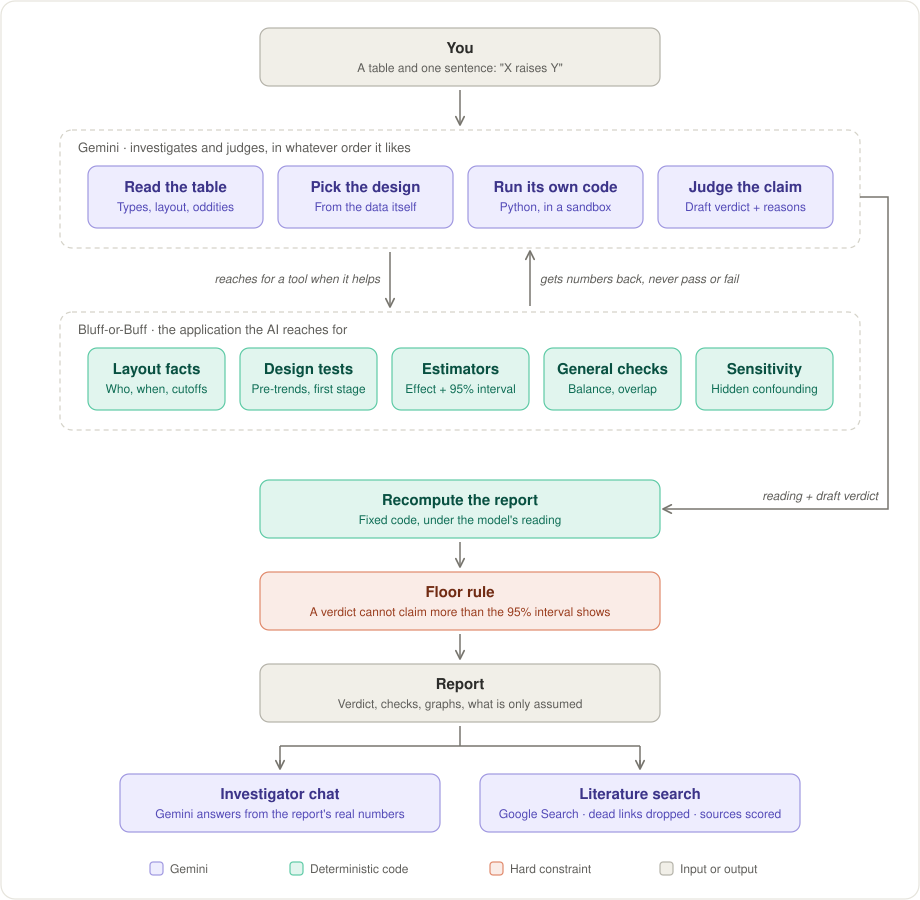

# Bluff-or-Buff

*Is that causal claim a bluff, or is it buff, with the data to back it up?*

Upload a table and a sentence like *"the scholarship raised test scores"*. Gemini investigates the data, and
statistics code decides how much it is allowed to claim. The one rule: **never claim more than the data can show.**

Built at HackPrinceton (Science & Discovery track, Gemini track).

## Install and run

You need a free Gemini API key for the model features. Without one the app still runs, on the rule-based analysis only.

**Docker**

```bash
git clone https://github.com/SilverBC/CausalityAI.git && cd CausalityAI
GEMINI_API_KEY=your-key docker compose up --build
```

Open http://localhost:8000.

**Without Docker** (Python 3.12, Node 18+)

```bash
python3.12 -m venv .venv && source .venv/bin/activate
pip install -r requirements.txt
(cd frontend && npm install && npm run build)
echo "GEMINI_API_KEY=your-key" > .env
python -m uvicorn app:app --app-dir backend --port 8000
```

**Try it in two minutes**

1. Click the sample **"Real: LaLonde NSW experiment"** and **Run analysis**. It is a randomized job-training study
   with a known answer (about +$1,800 a year). The app reports +$1,583, 95% CI 254 to 2,912.
2. Try **"Real: LaLonde vs PSID"**: the same trainees against a survey comparison group. A naive comparison gets the
   sign wrong (−$1,267). The grade drops to D and the verdict to Inconclusive.
3. Open the Investigator chat (bottom right) and ask about the result, or click **Investigate further** to search
   the literature for causes the dataset could not contain.

Settings, limits and the module list are in [docs/REFERENCE.md](docs/REFERENCE.md).

## How it works

<ins>**The application is the thing the AI reaches for, not the other way around.**</ins>

<p align="center"></p>

- **Gemini is in the middle.** It reads the table, writes and runs its own analysis, and calls our tools when it
  thinks they help. Nothing forces an order or a tool.
- **It writes down its reading**: treatment, outcome, study design and why, columns it left out, a draft verdict
  with reasons, assumptions and caveats.
- **Code recomputes everything** under that reading, so every number and chart in the report is reproducible.
- **Code holds one line.** The verdict cannot say Supported or Contradicted unless the recomputed 95% interval sits
  entirely on that side of zero. Otherwise it becomes Inconclusive and the page says why.
- **Afterwards**, the Investigator chat answers questions from the report, and the literature search adds causes
  from published research to the graph.

## Why this approach, and what it bought us

We built three versions and measured each.

| Version | What the model may do | Score on 21 claim-audit items |
|---|---|---|
| Fixed rule-based pipeline, no model | nothing | 2.4 |
| Model restricted to our tools | call tools only, in a loop | 84.6 |
| Plain frontier model, no tools | anything | 93.0 |
| **Model free, our tools on offer** | anything, plus our tools | **93.5** |

Restricting the model made it worse than leaving it alone. Offering the tools as options did not.

On 24 harder tables (simulated, known truth, no column descriptions, half with anonymised column names):

| | Over-claims (of 12 claims that should not be supported) | Missed real effects (of 10) |
|---|---|---|
| Frontier model, plain | 1 | 2 |
| Frontier model, restricted to tools | 0 | 4 |
| **Frontier model + tools on offer** | **0** | **1** |
| Gemini flash-lite, plain | 6 | 3 |
| **Gemini flash-lite + tools on offer** | **4** | 3 |

Why it helps:

- **The tools answer questions a model is bad at guessing from a bare table**: is treatment staggered over time, is
  there a cutoff, is the instrument strong. `layout_facts` was called on 22 of 24 tables by the frontier model.
- **Tools return numbers, never pass or fail.** The model interprets them. Labels in tool output steered it toward
  our assumptions.
- **Tool descriptions matter more for a small model.** With a vague prompt Gemini used the tools on 2 of 24 tables.
  With each tool described in full, 24 of 24.
- **The floor check catches what is left.** A small model still over-claims sometimes; in the web app those verdicts
  are downgraded by code.

Each configuration was run once per table, so small differences are within noise.

## Implementation choices

| We did | Instead of | Because |
|---|---|---|
| Let the model analyse freely and offer tools | A fixed pipeline, or a tool-only loop | Both scored below the plain model (table above) |
| One verdict rule in code: the interval floor | Many status and grading rules | Over-claiming is the costly error and the only one code can check without second-guessing the model |
| Recompute the report with fixed code under the model's reading | Showing the model's own numbers | Results are reproducible and every chart has code behind it |
| A hand-written agent loop over Gemini REST, with JSON-schema replies as tool calls | An SDK | No extra dependency, runs on the free tier, and tests replace the network with a fake |
| `gemini-2.5-flash-lite` for literature search, `gemini-3.5-flash-lite` for the rest | One model | Google's free tier has no Search allowance on Gemini 3 models |
| Request every cited link and drop missing hosts, 404 and 410 only | Trusting links, or dropping any non-200 | The model sometimes invents links; publishers often block robots on real pages |
| Run model-written code in a child process with keys removed and a time limit | Running it in the server process | The model's code should not see secrets or hang the app |

## Future improvements

Not done for lack of time:

- **Show the model's work.** The API returns its reading, reasons and every tool call; the page only shows the
  final verdict.
- **Ask the user when the table is ambiguous.** A version of the backend where the model can put a question to
  the user exists (`/api/audit`); the page does not use it yet.
- **Repeat the benchmarks.** One run per table cannot separate small gains from noise, and the hard cases are
  simulated. Next: several runs each and more real datasets with known answers.
- **Cut small-model over-claims further.** Gemini flash-lite still over-claims on 4 of 12; a second critic pass or
  a stronger model for the final judgement are the obvious tries.
- **Stronger source checks.** Use the links Google Search itself returns, and confirm each page matches the cited
  title.
- **A real sandbox** (container) for model-written code.
- **Score the claimed size.** "Raises Y by 60%" reads Supported when only the direction holds.
